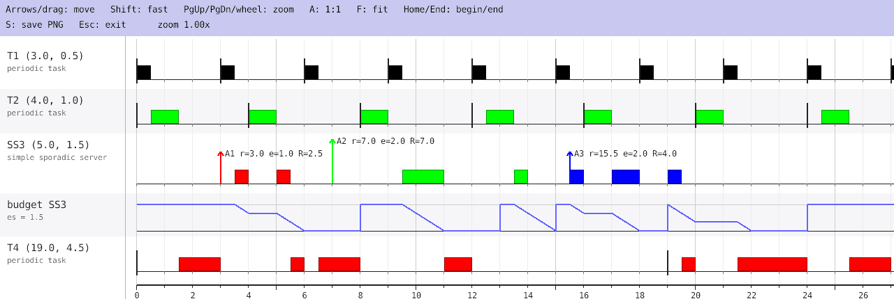

# RTSim

FEDERAL UNIVERSITY OF SANTA CATARINA - UFSC \
POSTGRADUATE PROGRAM IN AUTOMATION AND SYSTEMS ENGINEERING - PPGEAS \
Class: DAS6663 - Real Time Systems \
Author: Saulo Popov Zambiasi \
Software: RTSim \
Date: November 22, 2006 (modernized in 2026)

## About

RTSim simulates and visualizes the scheduling of a real-time task set on one
processor, using Rate Monotonic fixed priorities with preemption. Besides
periodic tasks it supports three aperiodic servers: polling, deferrable and
simple sporadic server (rules from Jane W. S. Liu, *Real-Time Systems*, 2000,
chapter 7).

I developed the first version in C++ and Allegro 4 during the Real Time
Systems discipline of my doctorate at PGEAS/UFSC in 2006, as a hobby, and
ended up using it to test and validate the exercises. In 2026 it was
rewritten on top of [raylib](https://www.raylib.com/), with the simulation
core separated from the graphics (see [History](#history)).



## Building

Requirements: a C++17 compiler and CMake >= 3.16. The viewer uses raylib 5.x:
if it is not installed, CMake downloads raylib 5.5 automatically (on Linux
this needs the X11/OpenGL development headers, e.g. on Debian/Ubuntu
`sudo apt install libgl-dev libx11-dev libxrandr-dev libxinerama-dev libxcursor-dev libxi-dev`).

```sh
cmake -S . -B build
cmake --build build
ctest --test-dir build        # unit tests of the simulation core
```

To build only the command line part, without any graphics dependency:

```sh
cmake -S . -B build -DRTSIM_GUI=OFF
```

## How to use

```sh
./build/rtsim samples/janeliu.in
```

This writes two files next to the input and then opens the viewer:

* `janeliu.out`: text report (schedulability analysis, response times, deadline misses)
* `janeliu.svg`: the timeline as a vector image (browser, Inkscape, LaTeX, slides)

Options:

```
--no-gui            only write the output files
--out FILE          text report path (default <file>.out)
--svg FILE          SVG path (default <file>.svg)
--length UNITS      simulate [0, UNITS) instead of the hyperperiod
--screenshot FILE   render the viewer once to a PNG and exit
```

By default the simulation covers one hyperperiod, extended if aperiodic jobs
are still pending, and limited to 5000 time units (use `--length` beyond that).

### Viewer keys

| Key | Action |
|---|---|
| Arrows, mouse drag | move (Left Shift: fast) |
| PageUp / PageDown, `+` / `-`, mouse wheel | zoom |
| `A` | zoom 1:1 |
| `F` | fit the whole simulation in the window |
| Home / End | go to the beginning / end |
| `S` | save the window as `rtsim_NNN.png` |
| Esc | exit |

The help bar also shows the time under the mouse cursor.

## Input format

```
type period computing [red green blue]
```

`period` is the period (or, for a server, its replenishment period `ps`) and
`computing` is the execution time (or the server budget `es`). The RGB color
is optional; without it a color-blind-safe palette (Okabe-Ito) is used.
Numbers accept either `.` or `,` as the decimal separator, with a resolution
of 0.1. Text after `#` is a comment.

`aperiodic` lines describe aperiodic jobs served by the server declared right
before them: `aperiodic release execution [r g b]`.

Example, `samples/janeliu.in` (the example of Liu's book, ch. 7):

```
periodic 3 0,5 0 0 0
periodic 4 1,0 0 255 0
periodic 19 4,5 255 0 0
simple_sporadic_server 5 1.5 100 100 255
aperiodic 3 1,0 255 0 0
aperiodic 7 2,0 0 255 0
aperiodic 15,5 2,0 0 0 255
```

Task types:

* `periodic`
* `polling_server` (`pooling_server`, the spelling of the old files, still works)
* `deferrable_server`
* `simple_sporadic_server` (or `sporadic_server`)
* `aperiodic`

`samples/janeliu_polling.in` and `samples/janeliu_deferrable.in` use the same
task set with the other servers, which is useful to compare them side by side.

## What the report contains

* Utilization and the Liu & Layland bound `n(2^(1/n) - 1)`. This test is only
  *sufficient*: failing it does not mean the set is unschedulable.
* Response Time Analysis, which is exact for this model (implicit deadlines,
  synchronous release). Polling and sporadic servers are analyzed as periodic
  tasks `(ps, es)`; the deferrable server's back-to-back execution is modeled
  as release jitter `ps - es`.
* For each periodic task: released jobs, deadline misses and the worst
  observed response time.
* For each aperiodic job: start, finish and **response time = finish - release**.

## Code structure

```
src/core/     model, parser, simulator, analysis, text report (no graphics)
src/render/   layout (drawing primitives) and the SVG writer
src/viewer/   raylib viewer, draws the same layout as the SVG
tests/        unit tests of the core
```

## History

The 2026 rewrite fixed several problems of the 2006 version, some of which
changed the results:

* Time was accumulated in a `float` (`time += 0.1`), so most ticks had the
  wrong index after t = 2.4 and period starts and replenishments happened one
  tick late. Time is now an integer number of ticks.
* Input was read with `fscanf`, which depends on the locale: in a given locale
  either `0,5` or `1.5` was misread (the old screenshot, `screenshot-2006.jpg`,
  shows the sporadic server budget as 1.0 instead of 1.5). Aperiodic release
  times were also truncated to integers (15.5 became 15).
* The aperiodic "response time" was computed as finish - start; it is now
  finish - release, as defined in the literature, and the finish time includes
  the last tick executed.
* The deferrable and polling servers ignored higher-priority tasks and could
  run at the same time as them.
* The simple sporadic server rules (C1, C2, R1-R3) were reimplemented and are
  checked against Liu's example in the tests.
* The Liu & Layland result was presented as a verdict; Response Time Analysis
  and deadline miss detection were added.
* Results were only saved when leaving the program with Esc; the main loop used
  100% of the CPU; buffer overflows with long file names and memory leaks were
  removed.
